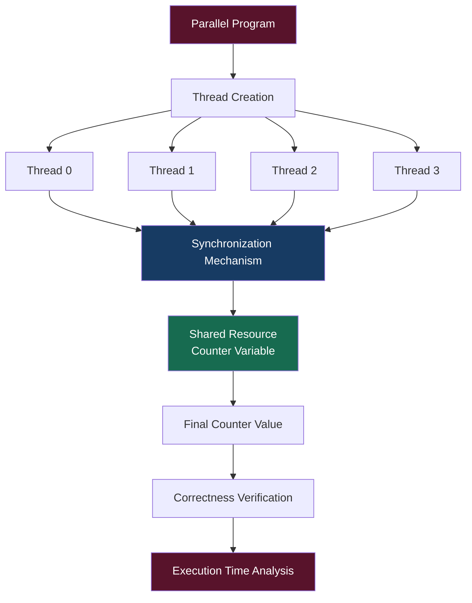
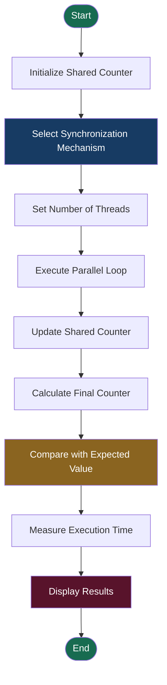
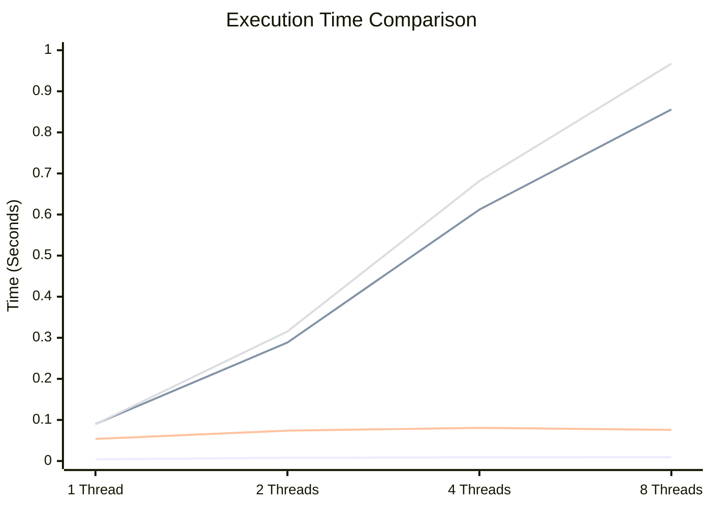

<div align="center">


## SYNCHRONIZATION MECHANISMS IN PARALLEL PROGRAMS

**Implementation, Analysis and Performance Evaluation of Thread Synchronization Techniques**

<br>


<br>

**PARALLEL PROGRAMMING AND COMPUTING LABORATORY**

</div>

---

# 1. PROJECT OVERVIEW

Synchronization is an essential concept in parallel programming where multiple threads execute simultaneously and access shared resources.

When multiple threads attempt to modify the same shared variable without proper coordination, race conditions may occur, resulting in incorrect outputs and data inconsistency.

This experiment focuses on implementing and analyzing different synchronization mechanisms using C, OpenMP and POSIX threads.

The experiment evaluates different synchronization techniques based on:

* Correctness of execution
* Execution time
* Thread synchronization
* Shared resource protection
* Performance and scalability

The primary objective is to understand how synchronization mechanisms maintain data consistency while balancing execution performance.

---

# 2. OBJECTIVES

1. Understand the importance of synchronization in parallel programming.
2. Implement race conditions using shared variables.
3. Implement critical sections and atomic operations.
4. Understand thread coordination using barriers.
5. Implement semaphore-based synchronization using POSIX threads.
6. Compare synchronization mechanisms using different thread counts.
7. Analyze execution time, correctness and scalability.

---

# 3. SYSTEM ARCHITECTURE

The experiment follows a shared-memory parallel programming architecture.

Multiple threads access a common shared counter. Depending on the synchronization mechanism used, access to the shared resource is either controlled or left unprotected.

## 3.1 Architecture Diagram



## 3.2 Synchronization Workflow

1. The program creates multiple threads.
2. Each thread performs operations on a shared counter.
3. A synchronization mechanism controls access to the shared resource.
4. The program calculates the final counter value.
5. The output is checked against the expected value.
6. Execution time is recorded for performance comparison.

---

# 4. SYNCHRONIZATION MECHANISMS IMPLEMENTED

## 4.1 Race Condition – No Synchronization

**Source File:** `race.c`

A race condition occurs when multiple threads access and modify the same shared variable without synchronization.

The counter increment operation involves reading, incrementing and writing the value.

When multiple threads execute these operations simultaneously, some updates may be lost.

**Implementation:**

```c
#pragma omp parallel for
for(long i = 0; i < 10000000; i++)
{
    counter++;
}
```

**Observations:**

* No synchronization overhead.
* Fast execution.
* Incorrect and unpredictable results with multiple threads.
* Demonstrates the importance of protecting shared resources.

## 4.2 Critical Section

**Source File:** `critical.c`

The critical section mechanism ensures that only one thread executes a protected block at a time.

It uses the OpenMP directive:

```c
#pragma omp critical
{
    counter++;
}
```

**Observations:**

* Prevents simultaneous updates.
* Guarantees correct counter values.
* Introduces waiting overhead.
* Performance may decrease as the number of threads increases.

## 4.3 Atomic Operation

**Source File:** `atomic.c`

Atomic operations provide protection for individual shared-variable updates.

It uses the OpenMP directive:

```c
#pragma omp atomic
counter++;
```

**Observations:**

* Prevents race conditions during individual updates.
* Maintains data consistency.
* Uses lightweight synchronization.
* Generally performs better than critical sections for simple updates.

## 4.4 Barrier Synchronization

**Source File:** `barrier.c`

A barrier is a synchronization point where every thread must arrive before any thread can continue execution.

**Implementation:**

```c
printf("Thread before barrier\n");

#pragma omp barrier

printf("Thread after barrier\n");
```

**Observations:**

* Coordinates multiple threads.
* Ensures synchronization between execution phases.
* Does not directly protect shared variables.
* Waiting time depends on the slowest thread.

## 4.5 Semaphore Synchronization

**Source File:** `semaphore.c`

A semaphore is a synchronization mechanism used to control access to shared resources.

This experiment uses a binary semaphore with an initial value of 1.

**Important Functions:**

| Function        | Purpose                   |
| --------------- | ------------------------- |
| `sem_init()`    | Initializes the semaphore |
| `sem_wait()`    | Acquires the semaphore    |
| `sem_post()`    | Releases the semaphore    |
| `sem_destroy()` | Destroys the semaphore    |

**Implementation:**

```c
sem_wait(&semaphore);

counter++;

sem_post(&semaphore);
```

**Observations:**

* Prevents simultaneous access to protected data.
* Maintains correct counter values.
* Introduces synchronization overhead.

## 4.6 Performance Comparison

**Source File:** `compare_sync.c`

A separate benchmarking program compares four synchronization mechanisms:

1. No Synchronization
2. Critical Section
3. Atomic Operation
4. OpenMP Lock

The same workload is executed using different thread counts.

The program measures execution time using:

```c
double start = omp_get_wtime();

long result = fn(nthreads);

double elapsed = omp_get_wtime() - start;
```

The final counter is compared against the expected value of 10,000,000 to determine correctness.

---

# 5. PROGRAM EXECUTION FLOW

The following flowchart represents the general execution process followed by the comparison program.



---

# 6. TECHNOLOGY STACK

| Technology         | Application                            |
| ------------------ | -------------------------------------- |
| C Programming      | Program implementation                 |
| Ubuntu Linux       | Execution environment                  |
| GCC Compiler       | Compilation of C programs              |
| OpenMP             | Parallel execution and synchronization |
| POSIX Threads      | Thread creation and management         |
| Semaphore Library  | Shared resource protection             |
| VMware Workstation | Virtual machine environment            |

---

# 7. PROJECT STRUCTURE

The repository is organized into source programs and execution results.

```text
PGC-LAB5-SYNCHRONIZATION/
│
├── race.c
├── critical.c
├── atomic.c
├── barrier.c
├── semaphore.c
├── compare_sync.c
│
├── README.md
│
└── results/
    ├── 00_ubuntu_update_and_gcc_openmp_setup.png
    ├── 01_gcc_installation_and_openmp_verification.png
    ├── 02_environment_setup_and_race_critical_execution.png
    ├── 03_race_critical_atomic_execution.png
    ├── 04_race_critical_atomic_barrier_execution.png
    ├── 05_critical_atomic_barrier_semaphore_execution.png
    └── 06_performance_comparison_1_2_4_8_threads.png
```

---

# 8. INSTALLATION AND CONFIGURATION

The experiment is implemented and executed in an Ubuntu Linux environment.

## Step 1: Update Ubuntu Packages

```bash
sudo apt update
```

## Step 2: Install GCC and Build Tools

```bash
sudo apt install build-essential -y
```

## Step 3: Verify GCC Installation

```bash
gcc --version
```

## Step 4: Verify OpenMP Support

```bash
echo '#include <omp.h>' | gcc -E -fopenmp -xc - > /dev/null && echo "OpenMP OK"
```

**Expected Output:**

```text
OpenMP OK
```

---

# 9. COMPILATION AND EXECUTION

The following commands are used to compile and execute the individual programs.

## 9.1 Race Condition

```bash
gcc race.c -fopenmp -o race
OMP_NUM_THREADS=4 ./race
```

## 9.2 Critical Section

```bash
gcc critical.c -fopenmp -o critical
OMP_NUM_THREADS=4 ./critical
```

## 9.3 Atomic Operation

```bash
gcc atomic.c -fopenmp -o atomic
OMP_NUM_THREADS=4 ./atomic
```

## 9.4 Barrier

```bash
gcc barrier.c -fopenmp -o barrier
OMP_NUM_THREADS=4 ./barrier
```

## 9.5 Semaphore

```bash
gcc semaphore.c -pthread -o semaphore
./semaphore
```

## 9.6 Performance Comparison

```bash
gcc compare_sync.c -fopenmp -o compare_sync
./compare_sync
```

---

# 10. EXPERIMENTAL CONFIGURATION

The performance comparison program uses the following configuration.

| Parameter                | Configuration                |
| ------------------------ | ---------------------------- |
| Programming Language     | C                            |
| Total Counter Increments | 10,000,000                   |
| Thread Counts            | 1, 2, 4, 8                   |
| Shared Resource          | Counter Variable             |
| Synchronization Methods  | None, Critical, Atomic, Lock |
| Performance Metric       | Execution Time (Seconds)     |
| Correctness Metric       | Final Counter Value          |

**Expected Correct Final Counter:**

```text
10000000
```

---

# 11. PERFORMANCE ANALYSIS

The following results are taken from the actual terminal execution of the comparison program.

## 11.1 Experimental Results

| Mechanism | Threads | Final Count | Correctness | Time (s) |
| --------- | ------: | ----------: | ----------- | -------: |
| None      |       1 |    10000000 | Correct     |   0.0042 |
| Critical  |       1 |    10000000 | Correct     |   0.0901 |
| Atomic    |       1 |    10000000 | Correct     |   0.0537 |
| Lock      |       1 |    10000000 | Correct     |   0.0896 |
| None      |       2 |     6037407 | Incorrect   |   0.0078 |
| Critical  |       2 |    10000000 | Correct     |   0.2884 |
| Atomic    |       2 |    10000000 | Correct     |   0.0739 |
| Lock      |       2 |    10000000 | Correct     |   0.3154 |
| None      |       4 |     4158087 | Incorrect   |   0.0090 |
| Critical  |       4 |    10000000 | Correct     |   0.6120 |
| Atomic    |       4 |    10000000 | Correct     |   0.0807 |
| Lock      |       4 |    10000000 | Correct     |   0.6815 |
| None      |       8 |     1969538 | Incorrect   |   0.0093 |
| Critical  |       8 |    10000000 | Correct     |   0.8558 |
| Atomic    |       8 |    10000000 | Correct     |   0.0759 |
| Lock      |       8 |    10000000 | Correct     |   0.9673 |

## 11.2 Execution Time Comparison

The following chart represents the execution time of all four mechanisms across different thread counts.



**Series order:**

1. None
2. Critical
3. Atomic
4. Lock

## 11.3 Performance Observations

**Race Condition:**

* Has the lowest execution time.
* Does not guarantee correct results with multiple threads.
* Lost updates increase with the number of threads in the observed runs.

**Critical Section:**

* Maintains correctness.
* Has higher execution time due to serialization.
* Performance decreases as thread contention increases.

**Atomic Operation:**

* Maintains correctness.
* Has relatively low synchronization overhead.
* Demonstrates the best performance among the synchronized mechanisms in this experiment.

**Lock:**

* Maintains correctness.
* Introduces waiting and locking overhead.
* Experiences increased contention as the number of threads increases.

---

# 12. CORRECTNESS AND SCALABILITY ANALYSIS

| Mechanism | Correctness                     | Relative Performance | Scalability      |
| --------- | ------------------------------- | -------------------- | ---------------- |
| None      | Incorrect with multiple threads | Fastest              | Poor             |
| Critical  | Correct                         | Slow                 | Poor             |
| Atomic    | Correct                         | Fast                 | Good             |
| Lock      | Correct                         | Slow                 | Poor to Moderate |
| Barrier   | Synchronization only            | Waiting overhead     | Moderate         |
| Semaphore | Correct                         | Moderate             | Moderate         |

### Key Findings

**Correctness:** Critical sections, atomic operations, locks and semaphores maintain correct counter values in their respective implementations.

**Performance:** Atomic operations show better performance than critical sections and locks in the observed comparison.

**Scalability:** Increasing the number of threads does not necessarily improve performance. Synchronization overhead and contention can reduce the benefits of parallel execution.

---

# 13. EXECUTION SCREENSHOTS

All screenshots below are captured from the actual Ubuntu terminal during the implementation and execution of the experiment.

## 13.1 Ubuntu Environment Setup

Shows Ubuntu package updates and initial environment preparation.


## 13.2 GCC Installation and OpenMP Verification

Shows GCC installation, compiler version verification and OpenMP support verification.


## 13.3 Environment Setup and Race/Critical Execution

Shows Lab5 directory creation, program compilation and execution of race condition and critical section programs.


## 13.4 Race Condition, Critical Section and Atomic Operation

Shows the compilation and execution of race, critical and atomic synchronization programs.


## 13.5 Barrier Synchronization Execution

Shows thread execution before and after the barrier synchronization point.


## 13.6 Semaphore Synchronization Execution

Shows the execution of critical, atomic, barrier and semaphore programs, including the final semaphore counter.


## 13.7 Final Performance Comparison

Shows the final comparison of None, Critical, Atomic and Lock mechanisms using 1, 2, 4 and 8 threads.


---

# 14. CONCLUSION

This experiment successfully demonstrates the implementation and analysis of different synchronization mechanisms in parallel programming.

Race conditions can produce incorrect results when multiple threads access shared variables without proper coordination.

Critical sections, atomic operations, locks and semaphores help maintain data consistency, while barriers coordinate the execution of multiple threads.

The performance comparison shows that different synchronization mechanisms have different execution costs depending on the number of threads and the workload.

Atomic operations provide a good balance between correctness and performance for simple shared-variable updates, while critical sections, locks and semaphores provide controlled access to shared resources.

Overall, this experiment provides practical understanding of thread synchronization, data consistency, execution time and scalability in shared-memory parallel systems.

---

<div align="center">

## PGC LAB 5 – SYNCHRONIZATION

**Analyze Synchronization Mechanisms in Parallel Programs**

Parallel Programming and Computing Laboratory

**END OF EXPERIMENT**

</div>
